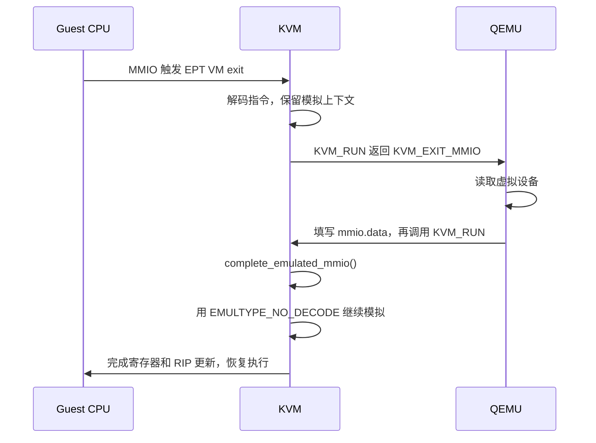

# x86 emulate

x86 kvm 代码行数统计，显然 emulate.c 是添加上很多的代码的，
所以，自然我们会问，为什么会这么复杂?
```txt
📂  vmx                18413      27.02 %
📂  svm                10906      16.35 %
💻  x86.c              10208      14.27 %
📂  mmu                8400       13.91 %
💻  emulate.c          4375       5.55 %
💻  lapic.c            2504       3.57 %
💻  hyperv.c           2174       2.88 %
💻  xen.c              1595       2.31 %
💻  cpuid.c            1477       2.14 %
```

## 整体印象
对应 : EMULTYPE_PF

./emulate-insn.bt 统计可以获取

emulate-insn-results.txt

## 什么触发了 instruction emulation
从 EMULTYPE_NO_DECODE

MMIO/PIO 是设备访问事件；EMULTYPE_* 是模拟器的执行标志，两者没有一一对应关系。

脚本只挂了 kvm_mmio、kvm_pio 两种设备访问 tracepoint，所以设备事件只显示这两类；但 CALL 中的 emulation_type 会记录所有标志。

其他标志需要特定条件：

 标志              为什么本次没有看到
━━━━━━━━━━━━━━━━  ━━━━━━━━━━━━━━━━━━━━━━━━━━━━━━━━━━━━━━━━━━━━━━━━━━━━━━━
 TRAP_UD           没有捕获到触发该入口的 #UD
────────────────  ───────────────────────────────────────────────────────
 SKIP              普通 VMX exit 已提供指令长度，通常直接更新 RIP
────────────────  ───────────────────────────────────────────────────────
 ALLOW_RETRY_PF    主要用于 shadow 写保护故障；MMIO 无法通过拆表重试解决
────────────────  ───────────────────────────────────────────────────────
 TRAP_UD_FORCED    需要启用强制模拟前缀；当前宿主配置为 0
────────────────  ───────────────────────────────────────────────────────
 VMWARE_GP         需要 VMware backdoor 兼容访问；当前宿主配置为 N


 场景                               为什么需要模拟
━━━━━━━━━━━━━━━━━━━━━━━━━━━━━━━━━  ━━━━━━━━━━━━━━━━━━━━━━━━━━━━━━━━━━━━━━━━━━
 被模拟的 MMIO                      完成访问设备的普通访存指令
─────────────────────────────────  ──────────────────────────────────────────
 INS/OUTS、REP 字符串 I/O           同时处理端口、内存、重复次数和寄存器更新
─────────────────────────────────  ──────────────────────────────────────────
 写受保护的 guest 页表              完成写入，同时维护 shadow 页表
─────────────────────────────────  ──────────────────────────────────────────
 旧 VMX 硬件的状态限制              软件执行到能够重新进入硬件运行的状态
─────────────────────────────────  ──────────────────────────────────────────
 特定 #UD、UMIP、VMware 兼容路径    补充特定指令行为或异常语义

### MMIO
guest 执行 mov dword ptr [rbx], eax：

- 如果访问 RAM，只是 EPT 映射缺失，修好映射后重试即可。
- 如果访问 QEMU 模拟的设备，那里没有可直接访问的 RAM；重试仍会退出。
- EPT exit 提供地址和访问属性，却没有给出完成任意指令所需的全部信息。KVM 必须解码，确定宽度、写入值、读结果去向，以及其他状态变化。

尤其是 MMIO 读：KVM 需要先退出到 QEMU 取得数据，再通过 EMULTYPE_NO_DECODE 继续完成同一条指令。
这也是你看到大量 complete_emulated_io() 调用的原因；

KVM API 说明 (https://docs.kernel.org/virt/kvm/api.html#the-kvm-run-structure)

### 其他场景

| 采集字段                 | 描述什么                                | 例子                                                      |
| ------------------------ | --------------------------------------- | --------------------------------------------------------- |
| CALL 的 `emulation_type` | 模拟入口的特殊标志                      | `PF`、`NO_DECODE`、`TRAP_UD`、`SKIP`                      |
| CALL 的 `exit_reason`    | 最近一次硬件 VM exit 原因               | EPT_VIOLATION、EPT_MISCONFIG、IO_INSTRUCTION、APIC_ACCESS |
| MMIO/PIO 记录            | 模拟过程中或专用 I/O 路径发生的设备访问 | 设备 GPA、端口、宽度、数据                                |

| `emulation_type`          |  次数 | 含义                                                           |
| ------------------------- | ----: | -------------------------------------------------------------- |
| `64 = 0x40 = EMULTYPE_PF` | 35089 | 经 MMU 页故障路径触发，本次样本中对应 MMIO                     |
| `1 = EMULTYPE_NO_DECODE`  |  1510 | 已解码指令的用户态 I/O 续接                                    |
| `0`                       |    55 | 完整模拟，没有设置特殊标志：48 次 string PIO、7 次 APIC access |

| 场景                                     | 为什么需要模拟                                                         | 当前源码入口                                                                     |
| ---------------------------------------- | ---------------------------------------------------------------------- | -------------------------------------------------------------------------------- |
| INS/OUTS，包括 REP 字符串 I/O            | 同时涉及端口、guest 内存、RSI/RDI、RCX、DF、权限及部分完成             | `vmx/vmx.c` 的 `handle_io()`                                                     |
| guest 写被跟踪的页表/内存                | KVM 要拦住写入并维护 shadow 页表或 page tracking，不能直接放开所有写入 | `mmu/mmu.c` 的 `kvm_mmu_write_protect_fault()`、`page_fault_handle_page_track()` |
| APIC access exit                         | 需要完成实际访问 APIC 页的指令；部分 EOI 写有专用快速路径              | `vmx/vmx.c` 的 `handle_apic_access()`                                            |
| VMX guest 状态不满足旧硬件 VM-entry 约束 | 先用软件执行，使状态回到能进入硬件执行的范围                           | `vmx/vmx.c` 的 `handle_invalid_guest_state()`                                    |
| 旧 VMX 的 real-mode/VM86 回退            | 例如某些合法 real-mode 指令在用于回退的 VM86 环境中产生 #GP/#SS        | `vmx/vmx.c` 的 `handle_rmode_exception()`                                        |
| 某些被截获的 #UD                         | 模拟特定兼容指令或 hypercall，而不是直接向 guest 注入 #UD              | `x86.c` 的 `handle_ud()`，`emulate.c` 的 `EmulateOnUD`                           |
| UMIP 的软件实现                          | 拦截描述符表相关指令，在 guest CPL 等条件下实现应有的效果/异常         | `vmx/vmx.c` 的 `handle_desc()`                                                   |
| VMware backdoor 兼容                     | 接管特定 #GP，放行约定的 IN/OUT、INS/OUTS、RDPMC                       | `EMULTYPE_VMWARE_GP`、`is_vmware_backdoor_opcode()`                              |
| 硬件没有提供足够的 decode assist         | 无法直接确定操作或下一 RIP，需要软件解码/执行                          | `svm/svm.c` 的 `invlpg_interception()`、`__svm_skip_emulated_instruction()`      |

### MMIO

### 2.3 实际入口

`arch/x86/kvm/vmx/vmx.c`、`vmx/common.h` 和 `mmu/mmu.c` 中的主路径：

```text
handle_ept_violation()
  -> __vmx_handle_ept_violation()
     -> kvm_mmu_page_fault()
        -> MMU 判定需要 RET_PF_EMULATE
           -> x86_emulate_instruction(..., EMULTYPE_PF, ...)
```

`EMULTYPE_PF` 表示传入的 CR2/GPA 有效，不表示所有缺页都需要模拟。

`kvm_mmu_page_fault()` 只有在处理结果是 `RET_PF_EMULATE` 时才调用模拟器。 正常
RAM 映射修复、重试或真正的 guest 页表权限错误，都有自己的处理结果。 尤其在通常的
EPT 配置下，guest 自己的普通 #PF 由硬件交给 guest，不必先退出到 KVM。

MMIO 还可能走另一条入口：

```text
handle_ept_misconfig()
  -> kvm_mmu_page_fault(..., PFERR_RSVD_MASK, ...)
     -> handle_mmio_page_fault()
        -> x86_emulate_instruction()
```

这是因为 KVM 可以用特殊的 MMIO SPTE 缓存“该 GPA 是 MMIO”，主动构造会引起 EPT
misconfiguration 的条目。这个场景中的 misconfig 不一定是页表出错。

### PIO

不是所有的 io 都是经过:

```c
  static int handle_io(struct kvm_vcpu *vcpu)
  {
      ...
      string = (exit_qualification & 16) != 0;   // 是否为串 I/O (rep ins/outs)

      if (string)
          return kvm_emulate_instruction(vcpu, 0);  // 走完整模拟 → 有 CALL/RETURN

      ...
      return kvm_fast_pio(vcpu, size, port, in);    // 走 fast PIO 路径 → 无 CALL/RETURN
  }
```

KVM 有两条 PIO 路径：

1. 串 I/O（rep ins/rep outs）：kvm_emulate_instruction() → x86_emulate_instruction()，fentry/fexit 探针命
   中 → 产生 CALL/INSN/RETURN；模拟器内部回调 emulator_pio_in_emulated/emulator_pio_out_emulated 时
   trace_kvm_pio 触发 → PIO 落在窗口内。

2. 非串 I/O（单条 in/out）：kvm_fast_pio() → kvm_fast_pio_in/out() → 直接调
   emulator_pio_in()/emulator_pio_out()（arch/x86/kvm/x86.c），这两个函数内部 trace_kvm_pio() 直接触发，根
   本不经过 x86_emulate_instruction，所以没有 CALL/RETURN。

## 基本流程

- x86_emulate_instruction
	- x86_emulate_insn
		- vcpu_mmio_write

如果检测到虚拟机中存在大量的这种调用，这市场不正常的
```txt
@[
        perf_trace_kvm_mmio+16
        vcpu_mmio_write+234
        emulator_read_write_onepage+170
        emulator_read_write+283
        x86_emulate_insn+1446
        x86_emulate_instruction+670
        vmx_handle_exit+18
        vcpu_enter_guest.constprop.0+2069
        vcpu_run+50
        kvm_arch_vcpu_ioctl_run+398
        kvm_vcpu_ioctl+879
        __x64_sys_ioctl+185
        do_syscall_64+226
        entry_SYSCALL_64_after_hwframe+118
]: 13218
```

```txt
         - 15.70% __x64_sys_ioctl                                                                                                                                                                                                                            ▒
            - 14.45% kvm_vcpu_ioctl                                                                                                                                                                                                                          ▒
               - 13.98% kvm_arch_vcpu_ioctl_run                                                                                                                                                                                                              ▒
                  - 5.44% vmx_handle_exit                                                                                                                                                                                                                    ▒
                     - 5.06% x86_emulate_instruction                                                                                                                                                                                                         ▒
                        - 3.13% x86_decode_emulated_instruction                                                                                                                                                                                              ▒
                           - 2.86% x86_decode_insn                                                                                                                                                                                                           ▒
                              - 2.28% __do_insn_fetch_bytes                                                                                                                                                                                                  ▒
                                 - 1.94% kvm_fetch_guest_virt                                                                                                                                                                                                ▒
                                    - 1.23% paging64_gva_to_gpa                                                                                                                                                                                              ▒
                                         1.06% paging64_walk_addr_generic                                                                                                                                                                                    ▒
                        - 1.66% x86_emulate_insn                                                                                                                                                                                                             ▒
                           - 0.72% emulator_read_write                                                                                                                                                                                                       ▒
                              - emulator_read_write_onepage                                                                                                                                                                                                  ▒
                                   0.52% write_mmio                                                                                                                                                                                                          ▒
                  - 2.17% vmx_vcpu_run                                                                                                                                                                                                                       ▒
                       0.53% native_write_msr                                                                                                                                                                                                                ▒
                  - 1.50% vmx_prepare_switch_to_guest                                                                                                                                                                                                        ▒
                     - 0.80% kvm_set_user_return_msr                                                                                                                                                                                                         ▒
                          0.55% native_write_msr_safe                                                                                                                                                                                                        ▒
                  - 1.49% fpu_swap_kvm_fpstate                                                                                                                                                                                                               ▒
                       0.76% restore_fpregs_from_fpstate                                                                                                                                                                                                     ▒
                  - 1.02% vcpu_put                                                                                                                                                                                                                           ▒
                     - 0.99% kvm_arch_vcpu_put                                                                                                                                                                                                               ▒
                          vmx_vcpu_put                                                                                                                                                                                                                       ▒
                  - 0.68% vcpu_load                                                                                                                                                                                                                          ▒
                       0.65% kvm_arch_vcpu_load                                                                                                                                                                                                              ▒
            - 0.64% kvm_vm_ioctl                                                                                                                                                                                                                             ▒
               - 0.56% kvm_send_userspace_msi                                                                                                                                                                                                                ▒
                  - 0.53% kvm_set_msi                                                                                                                                                                                                                        ▒
                       0.51% kvm_irq_delivery_to_apic
```

## 是不是因为需要处理变长指令 ?

- kvm_emulate_instruction ，进行完成模拟之后，就需要移动一下 ip ?

- 难道只有嵌套虚拟化的时候？
  - 不是，系统启动的时候也是存在的，但是之后，就无法
- 嵌套虚拟化需要额外

```c
	/* If guest state is invalid, start emulating.  L2 is handled above. */
	if (vmx->emulation_required)
		return handle_invalid_guest_state(vcpu);
```

并不是原因，因为 vmx_emulation_required 总是返回 0

```c
bool vmx_emulation_required(struct kvm_vcpu *vcpu)
{
	return emulate_invalid_guest_state && !vmx_guest_state_valid(vcpu);
}
```

主要的调用源头为:

- skip_emulated_instruction
- handle_io
- complete_emulated_io

## mmio 的两阶段运行

```txt
@[
    bpf_prog_815d6551cd4d7b0b_sd_fw_ingress+163
    bpf_prog_815d6551cd4d7b0b_sd_fw_ingress+163
    bpf_trampoline_354334906189+87
    x86_emulate_instruction+9
    kvm_arch_vcpu_ioctl_run+3265
    kvm_vcpu_ioctl+587
    __x64_sys_ioctl+148
    do_syscall_64+59
    entry_SYSCALL_64_after_hwframe+110
]: 78833
@[
    x86_emulate_instruction+9
    vmx_handle_exit+2034
    kvm_arch_vcpu_ioctl_run+1701
    kvm_vcpu_ioctl+587
    __x64_sys_ioctl+148
    do_syscall_64+59
    entry_SYSCALL_64_after_hwframe+110
]: 122776
```

### 3. I/O completion 为什么又进入模拟器

以 MMIO 读为例：

```asm
mov eax, dword ptr [rbx]
```

KVM 在拿到设备返回值之前，无法完成 EAX 写回。设备在用户态时，指令执行需要暂停：



对应 `arch/x86/kvm/x86.c` 的调用关系：

```text
kvm_arch_vcpu_ioctl_run()
  -> vcpu->arch.complete_userspace_io()
     -> complete_emulated_mmio() / complete_emulated_pio()
        -> complete_emulated_io()
           -> kvm_emulate_instruction(..., EMULTYPE_NO_DECODE)
```

`EMULTYPE_NO_DECODE` 复用之前的模式、解码结果和读缓存，不重新取指。 `emulate.c`
的 `read_emulated()` 按顺序使用已完成的读结果； `x86.c` 的
`emulator_read_write()` 处理 `mmio_read_completed`。
这是继续完成同一条指令，不能算成 guest 又执行了一条新指令。

读和写还不对称：

- MMIO 读：需要返回值，首次模拟暂不完成最终状态写回，返回后继续模拟。
- MMIO 写：写入数据已知，通常可以先完成指令模拟，再向用户态提交数据；
  `complete_emulated_mmio()` 完成最后一个写 fragment
  后直接返回，不再进入模拟器。
- 每个 `kvm_run.mmio.data` 最多承载 8 字节；跨页或较大的访问可能需要多个
  fragment、多个用户态往返。

所以，`complete_emulated_mmio()` 被调用，并不必然意味着下一步就是
`EMULTYPE_NO_DECODE`；要看读写方向和 fragment 是否全部完成。

KVM ABI 要求用户态重新进入 `KVM_RUN` 完成未结束的 I/O，不能因为已经收到一次
`KVM_EXIT_MMIO` 就认定操作全部结束。参见
[KVM API 的 KVM_RUN / KVM_EXIT_MMIO 说明](https://docs.kernel.org/virt/kvm/api.html#the-kvm-run-structure)。


### NO_DECODE 的含义

• NO_DECODE 的意思是：这条指令已经解码过了，复用解码结果，再执行模拟阶段。 用户态 I/O 续接是它最常见的用途。

  这里的 exit_reason 指脚本保存的 @exit_reason[tid]，它只在 硬件 VM exit 时更新。

  假设 guest 执行：

  mov eax, dword ptr [rbx]    ; 从 QEMU 模拟的设备读取数据

  整个过程如下：

  ① guest 执行 MOV，访问 MMIO
     → 硬件产生 EPT_MISCONFIG VM exit
     → 探针保存 @exit_reason[tid] = 49

  ② x86_emulate_instruction(PF)
     → 解码：知道这是 MOV，读 4 字节，结果写入 EAX
     → 执行模拟：发现需要 QEMU 提供设备数据
     → 保存模拟上下文
     → KVM_RUN 返回到 QEMU

  ③ QEMU 读取设备，填写 mmio.data
     → 再次调用 KVM_RUN

  ④ complete_emulated_mmio()
     → x86_emulate_instruction(NO_DECODE)
     → 复用之前的解码结果
     → 使用已经返回的设备数据完成 MOV
     → 写回 EAX，推进 RIP
     → 恢复 guest 执行

  ③ 到 ④ 期间，guest 没有执行，也就没有发生新的硬件 VM exit。 所以探针的 @exit_reason[tid] 仍然是第①步保存的 49。

  你因此会看到类似记录：

  CALL  ... emulation_type=64  exit_reason=49   # 首次模拟，PF
  INSN  ... mov eax,[rbx]
  RETURN ... 0                                # 需要用户态 I/O

  CALL  ... emulation_type=1   exit_reason=49   # 续接，NO_DECODE
  MMIO  ... read ...
  RETURN ... 1                                # 已完成

  这里有两次模拟器调用，却只有一次对应的硬件 VM exit。

  在 /home/martins3/data/kernel/linux-drm/arch/x86/kvm/x86.c 的 x86_emulate_instruction() 中，可以把逻辑理解成：

  if (!(emulation_type & EMULTYPE_NO_DECODE))
      x86_decode_emulated_instruction(...);

  x86_emulate_insn(...);

  所以 NO_DECODE 仍然会执行模拟。它复用指令、操作数和读缓存，完成剩余效果，避免重新取指解码、重复读取已经返回的数据。它也不是恢复之前暂停的 C 调用栈，而
  是再次调用模拟执行函数。

  INSN tracepoint 在解码阶段发出，因此这次续接通常有 CALL/RETURN，却没有新的 INSN 记录。

2026-10-01 不过，还是有东西对不上，记录的 backtrace 的数量，这个 completes 机制
此外，complate 机制本身也是需要继续思考下的。

## 有趣的东西
• 每秒 14～15 次的来源已经查到了：3 台 Linux VM 的 virtio-gpu 周期性刷新，主要对应文本控制台光标闪烁。

  我在当前机器上采样了 10 秒：

   虚拟机      vcpu_mmio_write 次数    写入的 guest 物理地址
  ━━━━━━━━━━  ━━━━━━━━━━━━━━━━━━━━━━  ━━━━━━━━━━━━━━━━━━━━━━━
   oe2403                        48    0x4800017000
  ──────────  ──────────────────────  ───────────────────────
   virtme/t                      48    0x4800023000
  ──────────  ──────────────────────  ───────────────────────
   yyds-fs                       48    0xe0212027000
  ──────────  ──────────────────────  ───────────────────────
   合计                         144    约 14.4 次/秒

  这三个地址都是各自 virtio-gpu 的 queue notify 寄存器，每次写 2 字节，值为 0，即通知控制队列。

  在 oe2403 guest 内进一步采样 5 秒，结果是：

  fb_flashcursor       24 次
  virtio_gpu_notify    24 次

  Linux 的 fbcon.c (/home/martins3/data/kernel/linux/drivers/video/fbdev/core/fbcon.c) 中，fbcon_open() 将光标闪烁
  间隔初始化为 HZ / 5，fb_flashcursor() 周期性更新光标。更新经过显示驱动，最终通过 MMIO 通知 virtio-gpu：

  光标闪烁 → 更新画面 → virtio_gpu_notify()
           → 写 queue notify → host 的 vcpu_mmio_write()

  因此，每台约 5 次/秒，3 台合计约 15 次/秒。延迟工作调度及统计窗口边界使实际显示在 14、15 之间变化。这个数字来自
  当前 guest 的活动，并非 KVM 固定每秒执行 15 次。

  Windows 启动后突然升高，需要采集新增访问的地址才能确定具体来源。 当前 Windows 没运行，所以这部分还没有实测结论。

### ioeventfd 的优化

  2. virtio-blk/net 也要写 MMIO，为什么没出现在这个计数里

  是的。现代 virtio-pci 的典型过程是：

  将描述符、数据放入 guest RAM 中的 virtqueue
      → 更新 available ring
      → 必要时写 MMIO notify 寄存器，通知设备处理

  数据通过共享内存队列传递，MMIO 写主要负责通知。 通知还可以合并、抑制，因此不必每个请求都写一次。Virtio
  官方内核文档 (https://cdn.kernel.org/doc/html/latest/driver-api/virtio/virtio.html)

  我通过 QMP 查询了当前 Windows 的实际设备属性：

   设备          ioeventfd
  ━━━━━━━━━━━━  ━━━━━━━━━━━
   virtio-vga    false
  ────────────  ───────────
   virtio-blk    true
  ────────────  ───────────
   virtio-net    true

  这造成了本机两条不同的处理路径：

  virtio-gpu 通知：
  MMIO 写 → VM exit → 指令模拟 → vcpu_mmio_write()
          → 返回 QEMU 处理

  启用 ioeventfd 的 blk/net 通知，快速路径命中时：
  MMIO 写 → VM exit → handle_ept_misconfig()
          → KVM_FAST_MMIO_BUS → eventfd 通知后端

  第二条路径跳过了完整指令模拟，也跳过了 vcpu_mmio_write()。 它仍然发生硬件 VM exit，只是 KVM 能更快处理；后端可以
  是 QEMU 的 I/O 线程，也可以是 vhost。

  这次也实际采到了 blk/net 的 kvm_fast_mmio 事件。例如 0x380800007030 落在启动盘的通知区域，0x38080000f004 落在网
  卡的通知区域。

  对应源码是 vmx.c (/home/martins3/data/kernel/linux/arch/x86/kvm/vmx/vmx.c) 中的 handle_ept_misconfig()，以及
  virtio-pci.c (/home/martins3/data/qemu/hw/virtio/virtio-pci.c) 中的 virtio_pci_ioeventfd_assign()。后者为现代通
  知地址注册不匹配长度和数据值的 eventfd，使 KVM 能仅凭访问地址完成通知。

  因此，观察 virtio 通知时，应同时看 vcpu_mmio_write 和 kvm:kvm_fast_mmio；只看前者，会漏掉大量磁盘和网络通知。
  Windows 目前保持运行。

### [ ] 这里还有网络和 virtio-blk 的差别

### 差不多是这个意思了吧

`x86.c` 的 `vcpu_mmio_read()/vcpu_mmio_write()` 会尝试内核 APIC 模型与
`KVM_MMIO_BUS`。总线上的设备包括可以通知 eventfd 的 ioeventfd：
`virt/kvm/eventfd.c` 的 `ioeventfd_write()` 匹配地址、长度以及可选的数据值后，
直接调用 `eventfd_signal()`。

因此，有些访问仍需要模拟指令以得到写入值和宽度，但设备侧已经在内核处理完，
不产生 `KVM_EXIT_MMIO`。普通 PIO 也会通过 `KVM_PIO_BUS` 尝试内核处理。

还有更专门的优化：仅匹配地址的 MMIO ioeventfd（注册长度为 0，不能设置
DATAMATCH） 同时注册到 `KVM_FAST_MMIO_BUS`。非 nested guest 的
`handle_ept_misconfig()` 可以先尝试这个总线；匹配成功后通知 eventfd
并跳过指令，省去完整模拟。 `handle_apic_access()` 的部分 EOI
写也有绕过通用模拟的快速路径。

“设备在内核处理”“需要指令模拟”“需要退出到 QEMU”应当分别判断。

## 附录
```c
/*
 * EMULTYPE_NO_DECODE - Set when re-emulating an instruction (after completing
 *			userspace I/O) to indicate that the emulation context
 *			should be reused as is, i.e. skip initialization of
 *			emulation context, instruction fetch and decode.
 *
 * EMULTYPE_TRAP_UD - Set when emulating an intercepted #UD from hardware.
 *		      Indicates that only select instructions (tagged with
 *		      EmulateOnUD) should be emulated (to minimize the emulator
 *		      attack surface).  See also EMULTYPE_TRAP_UD_FORCED.
 *
 * EMULTYPE_SKIP - Set when emulating solely to skip an instruction, i.e. to
 *		   decode the instruction length.  For use *only* by
 *		   kvm_x86_ops.skip_emulated_instruction() implementations if
 *		   EMULTYPE_COMPLETE_USER_EXIT is not set.
 *
 * EMULTYPE_ALLOW_RETRY_PF - Set when the emulator should resume the guest to
 *			     retry native execution under certain conditions,
 *			     Can only be set in conjunction with EMULTYPE_PF.
 *
 * EMULTYPE_TRAP_UD_FORCED - Set when emulating an intercepted #UD that was
 *			     triggered by KVM's magic "force emulation" prefix,
 *			     which is opt in via module param (off by default).
 *			     Bypasses EmulateOnUD restriction despite emulating
 *			     due to an intercepted #UD (see EMULTYPE_TRAP_UD).
 *			     Used to test the full emulator from userspace.
 *
 * EMULTYPE_VMWARE_GP - Set when emulating an intercepted #GP for VMware
 *			backdoor emulation, which is opt in via module param.
 *			VMware backdoor emulation handles select instructions
 *			and reinjects the #GP for all other cases.
 *
 * EMULTYPE_PF - Set when an intercepted #PF triggers the emulation, in which case
 *		 the CR2/GPA value pass on the stack is valid.
 *
 * EMULTYPE_COMPLETE_USER_EXIT - Set when the emulator should update interruptibility
 *				 state and inject single-step #DBs after skipping
 *				 an instruction (after completing userspace I/O).
 *
 * EMULTYPE_WRITE_PF_TO_SP - Set when emulating an intercepted page fault that
 *			     is attempting to write a gfn that contains one or
 *			     more of the PTEs used to translate the write itself,
 *			     and the owning page table is being shadowed by KVM.
 *			     If emulation of the faulting instruction fails and
 *			     this flag is set, KVM will exit to userspace instead
 *			     of retrying emulation as KVM cannot make forward
 *			     progress.
 *
 *			     If emulation fails for a write to guest page tables,
 *			     KVM unprotects (zaps) the shadow page for the target
 *			     gfn and resumes the guest to retry the non-emulatable
 *			     instruction (on hardware).  Unprotecting the gfn
 *			     doesn't allow forward progress for a self-changing
 *			     access because doing so also zaps the translation for
 *			     the gfn, i.e. retrying the instruction will hit a
 *			     !PRESENT fault, which results in a new shadow page
 *			     and sends KVM back to square one.
 *
 * EMULTYPE_SKIP_SOFT_INT - Set in combination with EMULTYPE_SKIP to only skip
 *                          an instruction if it could generate a given software
 *                          interrupt, which must be encoded via
 *                          EMULTYPE_SET_SOFT_INT_VECTOR().
 */
#define EMULTYPE_NO_DECODE	    (1 << 0)
#define EMULTYPE_TRAP_UD	    (1 << 1)
#define EMULTYPE_SKIP		    (1 << 2)
#define EMULTYPE_ALLOW_RETRY_PF	    (1 << 3)
#define EMULTYPE_TRAP_UD_FORCED	    (1 << 4)
#define EMULTYPE_VMWARE_GP	    (1 << 5)
#define EMULTYPE_PF		    (1 << 6)
#define EMULTYPE_COMPLETE_USER_EXIT (1 << 7)
#define EMULTYPE_WRITE_PF_TO_SP	    (1 << 8)
#define EMULTYPE_SKIP_SOFT_INT	    (1 << 9)
```
这是 flags ，不是种类的意思

## 好玩的东西
codex resume 01a143d4-19a6-7430-ab1a-efe2365ecb69

<script src="https://giscus.app/client.js"
        data-repo="martins3/martins3.github.io"
        data-repo-id="MDEwOlJlcG9zaXRvcnkyOTc4MjA0MDg="
        data-category="Show and tell"
        data-category-id="MDE4OkRpc2N1c3Npb25DYXRlZ29yeTMyMDMzNjY4"
        data-mapping="pathname"
        data-reactions-enabled="1"
        data-emit-metadata="0"
        data-theme="light"
        data-lang="zh-CN"
        crossorigin="anonymous"
        async>
</script>

本站所有文章转发 **CSDN** 将按侵权追究法律责任，其它情况随意。
