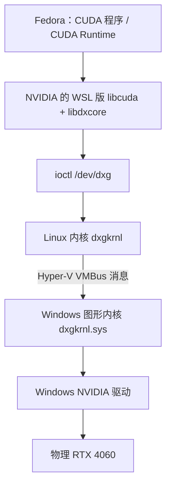

# GPUf
检查结果是：WSL 2 已经能识别本机 GPU；Hyper-V 有进一步尝试的条件，但现有虚拟机都还没有分配 GPU。

先确认型号：这台机器实际是 RTX 4060 Laptop GPU，8 GB 显存，驱动版本 591.74。你提到的 RTX 5060 也支持 WSL 2 CUDA 加速。NVIDIA
官方说明 (https://docs.nvidia.com/cuda/wsl-user-guide/index.html)                                                                                                                                                                                环境                  实测结果
Hyper-V 的关键区别：

- 宿主机能通过 Get-VMHostPartitionableGpu 枚举到 NVIDIA 显卡，说明驱动暴露了 GPU 共享接口，但这还不能保证来宾系统可用。
- 你的 Windows 11 Pro 配置不属于微软正式支持的普通虚拟机 GPU-P／DDA 部署范围；社区仍有 GPU-PV 实现。微软支持范围

(https://learn.microsoft.com/en-us/troubleshoot/windows-server/virtualization/troubleshoot-hyper-v-gpu-assignment-partitioning-passthrough-issues)

Hyper-V 虚拟机中如何使用上:
https://github.com/staralt/dxgkrnl-dkms

## WSL GPU-PV 的实现与源码入口

这里需要来宾内核、Windows 图形内核和 NVIDIA 驱动共同配合，采用的是 **WDDM GPU 半虚拟化（GPU-PV）**。VFIO 整卡直通把设备交给来宾驱动控制；WSL 中，物理 GPU 仍由 Windows 驱动管理。[微软架构说明](https://devblogs.microsoft.com/directx/directx-heart-linux/)

### 为什么 lsmod 中没有 NVIDIA 驱动

在本机的 Fedora WSL 中，`lsmod` 看不到 NVIDIA 驱动是正常的。2026-10-10 实际检查结果如下：

```text
内核：6.18.40.1-microsoft-standard-WSL2
CONFIG_DXGKRNL=y
/dev/dxg 存在
虚拟 PCI 设备：1414:008e，绑定 dxgkrnl
```

这里有两层原因：

- WSL 使用 Linux 侧的 **`dxgkrnl`** 对接宿主机，无需加载通常在原生 Linux 中使用的 `nvidia.ko`。
- `CONFIG_DXGKRNL=y` 表示它直接编进内核；`lsmod` 只显示动态加载的模块，因此连 `dxgkrnl` 也不会列出来。

### 从 CUDA 到物理 GPU 的控制路径



用动态链接器日志检查 CUDA 测试程序，可以看到它实际加载了：

```text
/usr/lib/wsl/lib/libcuda.so.1
/usr/lib/wsl/lib/libdxcore.so
/usr/lib/wsl/drivers/nvlti.inf_amd64_205d10e9dfea6908/libcuda.so.1.1
```

这些是 Windows 提供给 WSL 的 Linux 用户态库。CUDA 在这里对接 WDDM 提供的设备管理、内存和提交接口，CUDA kernel 仍在 NVIDIA GPU 上执行。[CUDA 接入方式](https://devblogs.microsoft.com/directx/directx-heart-linux/)

### Linux 侧源码入口

源码主要在微软的 WSL Linux 内核仓库。以下链接固定到与本机内核对应的 `linux-msft-wsl-6.18.40.1` 标签：

| 关注点 | 文件及阅读入口 |
|---|---|
| `/dev/dxg` 注册、PCI/VMBus 驱动初始化 | [`drivers/hv/dxgkrnl/dxgmodule.c`](https://raw.githubusercontent.com/microsoft/WSL2-Linux-Kernel/linux-msft-wsl-6.18.40.1/drivers/hv/dxgkrnl/dxgmodule.c)：`dxg_drv_init()`、`dxgk_fops`、`dxg_pci_probe_device()` |
| 用户态 ioctl ABI | [`include/uapi/misc/d3dkmthk.h`](https://raw.githubusercontent.com/microsoft/WSL2-Linux-Kernel/linux-msft-wsl-6.18.40.1/include/uapi/misc/d3dkmthk.h)：`LX_DX*` 宏及参数结构体 |
| ioctl 分发、参数检查、对象查找 | [`drivers/hv/dxgkrnl/ioctl.c`](https://raw.githubusercontent.com/microsoft/WSL2-Linux-Kernel/linux-msft-wsl-6.18.40.1/drivers/hv/dxgkrnl/ioctl.c)：`dxgk_unlocked_ioctl()`、`dxgk_ioctl()`、`ioctls[]` |
| 发往宿主机的消息协议 | [`drivers/hv/dxgkrnl/dxgvmbus.h`](https://raw.githubusercontent.com/microsoft/WSL2-Linux-Kernel/linux-msft-wsl-6.18.40.1/drivers/hv/dxgkrnl/dxgvmbus.h)：`DXGK_VMBCOMMAND_*` 及消息结构体 |
| 消息封装、内存共享、GPU 地址映射 | [`drivers/hv/dxgkrnl/dxgvmbus.c`](https://raw.githubusercontent.com/microsoft/WSL2-Linux-Kernel/linux-msft-wsl-6.18.40.1/drivers/hv/dxgkrnl/dxgvmbus.c)：`dxgvmb_send_sync_msg()`、`dxgvmb_send_async_msg()`、`create_existing_sysmem()`、`dxgvmb_send_map_gpu_va()` |
| 通用 VMBus 传输与共享页机制 | [`drivers/hv/channel.c`](https://raw.githubusercontent.com/microsoft/WSL2-Linux-Kernel/linux-msft-wsl-6.18.40.1/drivers/hv/channel.c)：`vmbus_sendpacket()`、`vmbus_establish_gpadl()` |

例如，源码中一条命令提交路径是：

```text
dxgk_unlocked_ioctl()
  → dxgk_ioctl()
  → ioctls[] 中的 LX_DXSUBMITCOMMAND
  → dxgkio_submit_command()
  → dxgvmb_send_submit_command()
  → 同步或异步消息发送
  → vmbus_sendpacket()
  → Windows 宿主机
```

这是可直接追踪的一条提交路径；具体 CUDA 调用也可能涉及硬件队列或厂商私有接口，不能简单认为每次 kernel launch 都与它一一对应。

### 从 IOMMU/VFIO 的角度阅读内存共享实现

最值得先读的是 `dxgvmbus.c` 中的 **`create_existing_sysmem()`**。它展示了双方如何配合访问来宾内存：

1. 来宾使用 `pin_user_pages_fast()`，带 `FOLL_LONGTERM` 固定用户页。
2. 根据宿主机协商的能力，通过 GPADL 描述这些页，或者把来宾 PFN 列表发给宿主机。
3. 宿主机建立 GPU 访问这些页所需的映射。

GPU 虚拟地址映射则可以继续追 `dxgkio_map_gpu_va()` → `dxgvmb_send_map_gpu_va()`。这里涉及来宾物理页、GPU VA、宿主机映射等不同地址空间，不能直接把 GPADL 当作 VFIO 的 IOVA 映射。[内存共享实现](https://raw.githubusercontent.com/microsoft/WSL2-Linux-Kernel/linux-msft-wsl-6.18.40.1/drivers/hv/dxgkrnl/dxgvmbus.c)

### Windows 宿主机侧的配合与源码边界

Windows 图形内核和 NVIDIA Windows 驱动的完整实现没有对应的公开源码可一路追下去，但微软公开了驱动接口要求，例如 `DxgkDdiCreateProcess()` 的虚拟机标志、`DxgkDdiSetVirtualMachineData()`，以及 IOMMU 隔离相关约束。研究到这条边界时，可以接着读 [GPU paravirtualization 驱动文档](https://learn.microsoft.com/en-us/windows-hardware/drivers/display/gpu-paravirtualization)。

## 这是 windows 独有的方案

linux 中的 virtio-gpu 存在非常类似方案，但是并不是一样的，那个是不支持 nvidia 的 GPU

最接近的方案应该是这个了:
https://github.com/nestrilabs/virtio-nvgpu

<script src="https://giscus.app/client.js"
        data-repo="martins3/martins3.github.io"
        data-repo-id="MDEwOlJlcG9zaXRvcnkyOTc4MjA0MDg="
        data-category="Show and tell"
        data-category-id="MDE4OkRpc2N1c3Npb25DYXRlZ29yeTMyMDMzNjY4"
        data-mapping="pathname"
        data-reactions-enabled="1"
        data-emit-metadata="0"
        data-theme="light"
        data-lang="zh-CN"
        crossorigin="anonymous"
        async>
</script>

本站所有文章转发 **CSDN** 将按侵权追究法律责任，其它情况随意。
